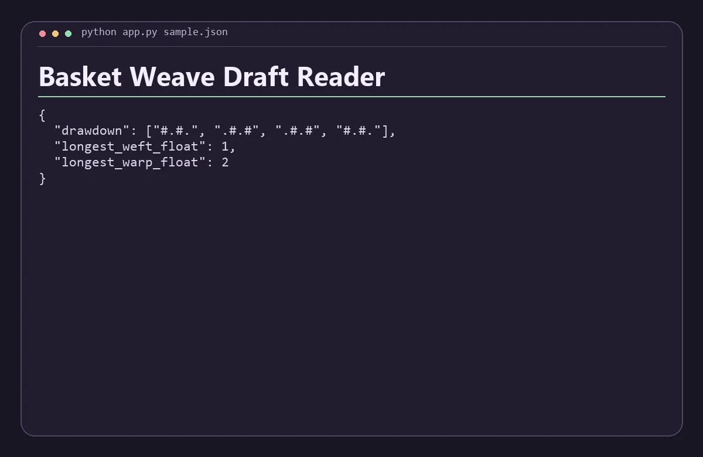

# Basket Weave Draft Reader

Render a loom lift plan as a text drawdown and measure horizontal weft floats and vertical warp floats.



## Run

Install Python 3.11 or newer. Run these commands from the repository root.

```sh
python app.py sample.json
```

Replace `sample.json` with a JSON file following the same structure. The app prints a JSON report to standard output.

Number shafts from one. Each lift lists the raised shafts for one pick. Warp above weft appears as # and weft above warp as a period. Float lengths are counted within the supplied rectangle, without wrapping.

## Verify

Run `python check.py` with Python 3.11 or newer after the build step when applicable. The check verifies the bundled scenario and confirms that an invalid input returns an error.
